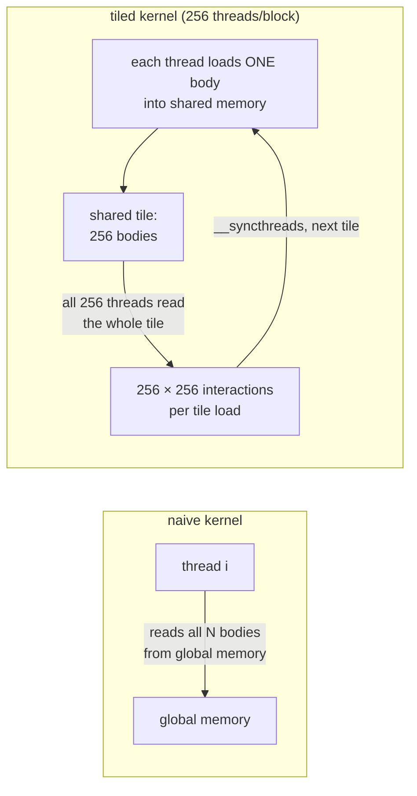

# cuda-nbody

Direct-summation gravitational N-body in CUDA. It has a naive kernel and a **shared-memory tiled**
kernel, both checked against a double-precision CPU reference, plus a symplectic leapfrog integrator
that runs entirely on the device.


Two Plummer-sphere star clusters, 3,000 stars in total, collide and pass through each other.
Computed on the GPU (RTX 4050 Laptop); total energy is conserved to 8.3 × 10⁻⁶ over the run.

## Naive vs tiled

Every body pulls on every other body: N² interactions per step, each about 20 flops, reading 16
bytes (position + mass).



- **Naive.** Each thread streams all N bodies from global memory: N² loads per step, about 1.3 flops
  per byte loaded. On paper that is bandwidth-bound; the measurements below show why it isn't, on a
  modern GPU.
- **Tiled.** A block cooperatively loads 256 bodies into shared memory once, and every thread in the
  block uses all of them, so global loads drop by the tile size (256×). This is the classic design
  from Nyland, Harris & Prins (GPU Gems 3, ch. 31).
- **Softening.** $\mathbf a_i = \sum_j m_j \mathbf r_{ij}/(r_{ij}^2+\varepsilon^2)^{3/2}$. With ε > 0, the
  self-interaction term is exactly zero (r = 0), so there's no branch in the inner loop. Padding
  bodies in the last tile get zero mass, for the same reason.
- `rsqrtf` with `-use_fast_math` gives one fast reciprocal square root per interaction. Float
  accuracy is checked against the double reference in the tests.

## Measured

On an NVIDIA GeForce RTX 4050 Laptop GPU (Ada, sm_89) under Windows 11, built with nvcc 13.4 and
`-use_fast_math`. The CPU column is the double-precision OpenMP reference on the same laptop's AMD
Ryzen 7 7735HS (8 cores, 16 threads). Times are per force evaluation (all N² interactions), and
GFLOP/s uses the conventional 20 flops per interaction.

| N | CPU, double | GPU naive | GPU tiled | tiled / naive |
|---:|---:|---:|---:|---:|
| 1,024 | 2.50 ms (8 GF/s) | 0.044 ms (472 GF/s) | 0.040 ms (522 GF/s) | 1.1× |
| 4,096 | 9.46 ms (36 GF/s) | 0.196 ms (1,712 GF/s) | 0.077 ms (4,357 GF/s) | 2.5× |
| 16,384 | 140 ms (38 GF/s) | 1.23 ms (4,373 GF/s) | 1.07 ms (5,029 GF/s) | 1.15× |
| 65,536 | not run | 18.9 ms (4,554 GF/s) | 16.1 ms (5,328 GF/s) | 1.17× |

What the numbers say:

- **Tiling helps far less than the 256× cut in loads suggests.** In the naive kernel all 32 threads of
  a warp read the same body at the same moment, so each load is one broadcast, and the stream of
  bodies is served from the L1/L2 caches. GPUs have cached global memory since Fermi (2010); the
  G80 that the GPU Gems design targeted did not. This is the likely explanation, not a profiled one:
  the kernels have not been run under Nsight.
- **N = 1,024 is too small to fill the GPU.** It is only 4 blocks of 256 threads, so both kernels
  are limited by occupancy rather than by memory or arithmetic.
- **GPU vs CPU** is about 130× at N = 16,384, but it compares float on the GPU with double on the
  CPU. Treat it as a scale, not a like-for-like speed-up.

The GPU tests pass on this card: the naive kernel matches the double CPU reference to a maximum
relative error of 3.3 × 10⁻⁶, the tiled kernel matches the naive one exactly, and the on-device
leapfrog's energy error after one time unit is 1.4 × 10⁻⁶.

## Tests

CPU (always run):

| test | what it checks |
|---|---|
| two-body accelerations | match Newton's law with softening, to 1e-12 |
| momentum conservation | internal forces cancel: Σ m·a ≈ 0 relative to Σ m\|a\| |
| Plummer initial conditions | E = −1/4 in Hénon units |
| leapfrog | energy error 7 × 10⁻⁷ after one time unit (N = 500, dt = 1/256) |
| collision set-up | zero net momentum |

GPU (`tests/test_gpu.cpp`, run automatically when a device exists, otherwise reported *skipped*):
the naive kernel against the double CPU reference (relative error < 1e-3), the tiled kernel against
the naive one (< 1e-5) on N = 5,000 (not a multiple of the tile size, to exercise padding), and
energy conservation of the on-device integrator.

## Build and run

```bash
cmake -S . -B build -DCMAKE_BUILD_TYPE=Release    # uses CUDA if nvcc is found
cmake --build build -j
ctest --test-dir build --output-on-failure
./build/nbody_bench
./build/collide 1500 docs/collision.csv && python scripts/plot_collision.py
```

With `-DNB_USE_CUDA=OFF`, or without nvcc, the CPU path builds on its own.

By default the kernels are built for sm_75 to sm_89, plus sm_70 with CUDA 12 or older (CUDA 13
dropped Volta). To build for one card only, configure a fresh build directory with, for example,
`-DCMAKE_CUDA_ARCHITECTURES=89` for an RTX 40-series GPU.

The measurements above were built without CMake, from a Visual Studio x64 developer prompt:

```bat
nvcc -O3 -std=c++17 -arch=sm_89 -use_fast_math -Iinclude -Xcompiler "/O2 /openmp" src/cpu.cpp src/gpu.cu app/bench.cpp -o nbody_bench.exe
```

## References

- L. Nyland, M. Harris, J. Prins, *Fast N-Body Simulation with CUDA*, GPU Gems 3, ch. 31 (2007).
- S. J. Aarseth, M. Hénon, R. Wielen, *A comparison of numerical methods for the study of star cluster dynamics*, Astron. Astrophys. 37, 183–187 (1974).

## License

MIT
