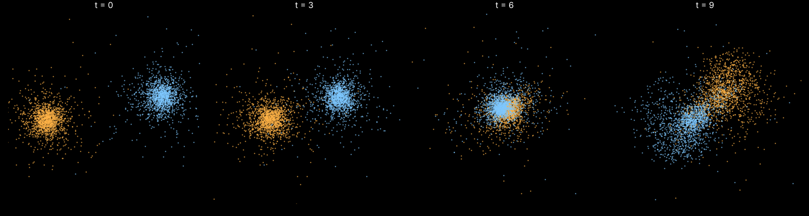
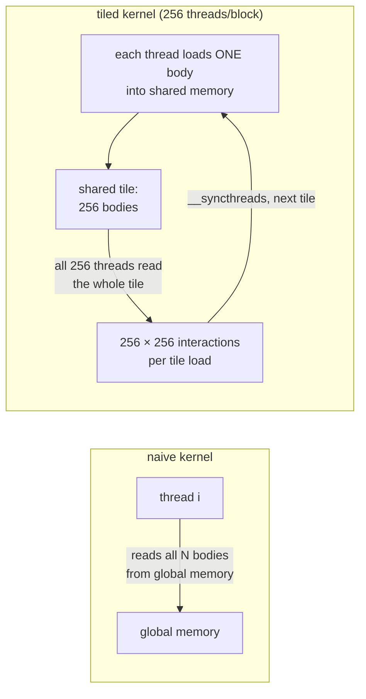

# cuda-nbody

Direct-summation gravitational N-body in CUDA. It has a naive kernel and a **shared-memory tiled**
kernel, both checked against a double-precision CPU reference, plus a symplectic leapfrog integrator
that runs entirely on the device.



Two Plummer-sphere star clusters, 3,000 stars in total, collide and pass through each other. Total
energy is conserved to 8 × 10⁻⁶ over the run. *This image was computed with the CPU reference
path, because the development machine has no GPU. `collide` uses the GPU automatically when one is
present.*

## Why tiling matters

Every body pulls on every other body: N² interactions per step, each about 20 flops, reading 16
bytes (position + mass).



- **Naive.** Each thread streams all N bodies from global memory: N² loads per step. That is about
  1.3 flops per byte, so the kernel is bandwidth-bound.
- **Tiled.** A block cooperatively loads 256 bodies into shared memory once, and every thread in the
  block uses all of them. Global traffic drops by the tile size (256×), and the kernel becomes
  compute-bound. This is the classic design from Nyland, Harris & Prins (GPU Gems 3, ch. 31).
- **Softening.** $\mathbf a_i = \sum_j m_j \mathbf r_{ij}/(r_{ij}^2+\varepsilon^2)^{3/2}$. With ε > 0, the
  self-interaction term is exactly zero (r = 0), so there's no branch in the inner loop. Padding
  bodies in the last tile get zero mass, for the same reason.
- `rsqrtf` with `-use_fast_math` gives one fast reciprocal square root per interaction. Float
  accuracy is checked against the double reference in the tests.

## Measured

CPU reference (double precision, OpenMP, 2-vCPU cloud VM):

| N | time per force evaluation | throughput |
|---:|---:|---:|
| 1,024 | 2.5 ms | 8.3 GFLOP/s |
| 4,096 | 32 ms | 10.4 GFLOP/s |
| 16,384 | 635 ms | 8.5 GFLOP/s |

**GPU numbers are not included because they were not measured.** There was no GPU on the machine
this was written on. The kernels compile with nvcc for sm_70, 75, 80 and 86, and CI builds them in an
NVIDIA CUDA container. On a machine with a GPU, `./build/nbody_bench` fills in the naive and tiled
columns. Tiled should beat naive clearly at large N; measure it rather than taking that on trust.

## Tests

CPU (always run):

| test | what it checks |
|---|---|
| two-body accelerations | match Newton's law with softening, to 1e-12 |
| momentum conservation | internal forces cancel: Σ m·a ≈ 0 relative to Σ m\|a\| |
| Plummer initial conditions | E = −1/4 in Hénon units |
| leapfrog | energy error 7 × 10⁻⁷ after one time unit (N = 500, dt = 1/256) |
| collision set-up | zero net momentum |

GPU (`tests/test_gpu.cpp`, run automatically when a device exists, otherwise reported *skipped*):
the naive kernel against the double CPU reference (relative error < 1e-3), the tiled kernel against
the naive one (< 1e-5) on N = 5,000 (not a multiple of the tile size, to exercise padding), and
energy conservation of the on-device integrator.

## Build and run

```bash
cmake -S . -B build -DCMAKE_BUILD_TYPE=Release    # uses CUDA if nvcc is found
cmake --build build -j
ctest --test-dir build --output-on-failure
./build/nbody_bench
./build/collide 1500 docs/collision.csv && python scripts/plot_collision.py
```

With `-DNB_USE_CUDA=OFF`, or without nvcc, the CPU path builds on its own.

## References

- L. Nyland, M. Harris, J. Prins, *Fast N-Body Simulation with CUDA*, GPU Gems 3, ch. 31 (2007).
- S. J. Aarseth, M. Hénon, R. Wielen, *A comparison of numerical methods for the study of star cluster dynamics*, Astron. Astrophys. 37, 183–187 (1974).

## License

MIT
